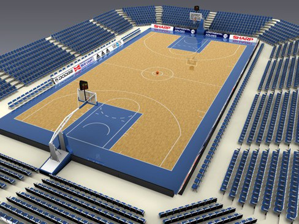
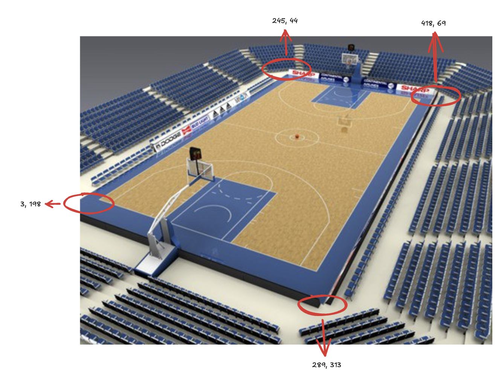
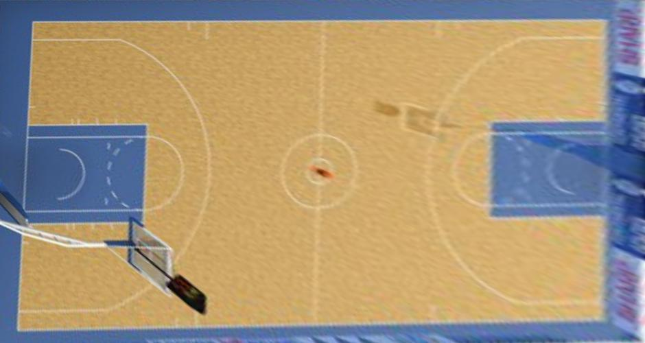
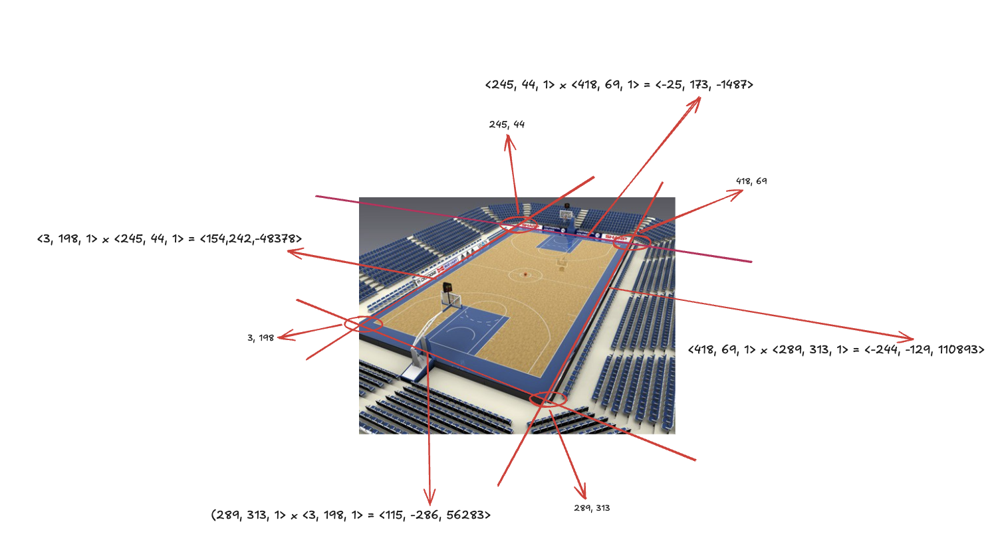

## 1. Homography Estimation

### Objective: Image Warping

### Implementation:
Implement DLT algorithm for homography estimation using pixel feature locations. Perform 2D bilinear interpolation to render the output image. Implement the DLT algorithm for homography estimation using line feature locations.

### Results: 
The original image is a basketball court. 

The output images are warped using points and lines taken directly from the source image to appear as if it was taken from a top-view perspective. 

First step is to take the points of four corners from the source image. In this case: [289, 313], [3, 198], [418, 69], [245, 44], to be interpolated at four destination points [0, 0] (top left), [0, 499] (bottom left), [939, 0] (top right), [939, 499] (bottom right). [RedKetchup](https://redketchup.io/color-picker) was used to find the exact source points to warp.

Through the direct linear transformation, we compute the homography matrix H.

H from points:

$$
\begin{bmatrix}
1.05608717e-03 & -2.62644289e-03 & 5.16867430e-01\\
-1.88360083e-03 & -9.95838145e-04 & 8.56057980e-01\\
1.23622411e-07 & 4.13034800e-06 & 4.90900840e-04
\end{bmatrix}
$$

Then, this homography matrix was applied to the source image onto an output image of 940x500.

DLT using points:

To compute DLT using lines, the source lines and destination lines were computed by taking the cross products of two points.

H from lines:

$$
\begin{bmatrix}
1.05608717e-03 & -2.62644289e-03 & 5.16867430e-01\\
-1.88360083e-03 & -9.95838145e-04 & 8.56057980e-01\\
1.23622411e-07 & 4.13034800e-06 & 4.90900840e-04
\end{bmatrix}
$$

DLT using lines:

